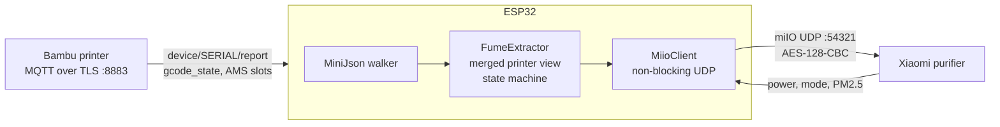

# mqtt_purifier

[](https://github.com/3dfarmers/mqtt_purifier/actions/workflows/build.yml)

**Your 3D printer switches its own air purifier.** An ESP32 watches a Bambu Lab
printer over its local MQTT. When a print starts with **ABS or ASA**, it turns a
**Xiaomi air purifier** on in auto mode. When the print ends (finished, failed
or cancelled), it turns the purifier off **10 minutes** later. While the purifier
runs, the ESP32 logs its **PM2.5** reading every 10 seconds.

- No cloud, no Home Assistant, no smart plug: everything stays on your LAN.
- Any ESP32 with WiFi (ESP32, S2, S3, C3, C6). No wiring, no pins.
- Non-blocking: the purifier exchange never stalls your loop.
- Works as a **complete firmware** or as a **library** you drop into firmware
  that already talks to the printer.
- Not limited to Bambu: any printer can feed it a print state and a filament.

```
[FUME] Active slot: A2 = ASA
[FUME] RUNNING with ASA (slot A2) -> purifier ON, auto mode
[FUME] Purifier ON confirmed (408 ms; codes power 0)
[FUME] Auto mode set (codes mode 0)
[FUME] 00:19:14 AQI 2 ug/m3 | power on | auto | ON 00:00:01 | RUNNING
```

(From the bench log, P1S printing ASA. At the end of a print the log reads
`Print FINISH -> purifier OFF in 10 min`, then `Run-on over -> purifier OFF`.)

Built by [3D Farmer](https://github.com/3dfarmers) for the FarmLoop
FarmBoard, then cut loose from it so anyone can use it. Bench-tested on a
Bambu Lab **P1S** with one AMS and a **Xiaomi Mi Air Purifier 3C**
(`zhimi.airp.mb4a`, firmware 2.1.7); see [docs/bench-notes.md](docs/bench-notes.md).

> **Honest note on fumes.** A HEPA filter catches the particles (UFPs) well.
> For the gases (VOCs, styrene from ABS/ASA) the purifier's activated-carbon
> layer only partly helps. This is not a replacement for an enclosure with
> proper ventilation to the outside.

**Using an AI coding agent?** Point it at [AGENTS.md](AGENTS.md): a complete
rebuild/port specification with every protocol detail and bench finding.

---

## Contents

- [How it works](#how-it-works)
- [What you need](#what-you-need)
- [Quick start](#quick-start)
- [Getting the purifier token](#getting-the-purifier-token)
- [Console commands](#console-commands)
- [Add it to your own firmware](#add-it-to-your-own-firmware)
- [Other purifiers, printers and boards](#other-purifiers-printers-and-boards)
- [Behaviour in detail](#behaviour-in-detail)
- [Troubleshooting](#troubleshooting)
- [Repository layout](#repository-layout)
- [Credits and references](#credits-and-references)

---

## How it works



1. **Printer in.** The ESP32 subscribes to `device/<SERIAL>/report` on the
   printer's local MQTT broker and asks for a full state dump (`pushall`).
   P1/A1/P2S printers then send only the fields that changed, so the library
   keeps a merged picture: `gcode_state`, the filament type of every AMS slot,
   the external spool, the active slot (`tray_now`) and, when the printer
   echoes the print command, the job's own slot list.
2. **Decision.** Print under way (`PREPARE`, `RUNNING`, `PAUSE`) and a fume
   filament in the job or the active slot: purifier on. Print over
   (`FINISH`, `FAILED`, `IDLE`): start the run-on timer, then off. Full table:
   [docs/state-machine.md](docs/state-machine.md).
3. **Purifier out.** Xiaomi's miIO protocol over UDP: a hello returns the
   device id and uptime stamp, then an AES-128-CBC encrypted JSON command
   (`set_properties` / `get_properties`). Byte-level description with a test
   vector: [docs/miio-protocol.md](docs/miio-protocol.md).

Commands are sent on **transitions only**. Once the purifier confirmed one,
nothing is re-sent, so pressing its button or using the Mi Home app in between
is respected.

## What you need

| Item | Notes |
|---|---|
| ESP32 board | Any with WiFi: ESP32, S2, S3, C3, C6 (all compile; bench-tested on S3). See [porting](docs/porting.md#other-esp32-boards). |
| Arduino-ESP32 core 3.x | Tested with 3.3.8 (Arduino IDE 2 or arduino-cli). PlatformIO works with the same core. |
| PubSubClient 2.8 | Library Manager, by Nick O'Leary. Only the Bambu example needs it. |
| Bambu Lab printer | Bench-tested on a P1S in LAN only mode. X1, P1, A1, P2S and H2 use the same report format (H2D dual-nozzle slot reporting is unverified). You need the IP, LAN access code and serial number from the printer screen. |
| Xiaomi MIoT purifier | Defaults for the **Mi Air Purifier 3C** (`zhimi.airp.mb4a` / `zhimi.airpurifier.mb4`). Others: [porting](docs/porting.md#other-purifiers). |
| Purifier token | 32 hex characters, see [below](#getting-the-purifier-token). |
| 2.4 GHz WiFi | Same subnet for ESP32, printer and purifier. Give the purifier a DHCP reservation. **Aim for better than -70 dBm at the ESP32** ([why](#troubleshooting)). |

## Quick start

### 1. Check the purifier from your laptop (optional, 1 minute)

[tools/miio.py](tools/miio.py) needs only Python 3, no packages:

```bash
python tools/miio.py hello --ip 192.168.1.50
```

```bash
MIIO_TOKEN=0123456789abcdef0123456789abcdef python tools/miio.py info --ip 192.168.1.50
```

`hello` needs no token: if it answers, IP and network are right. `info` prints
the model string; if it answers, the token is right too. `status`, `on` and
`off` work the same way.

### 2. Flash the complete firmware

1. Install the Arduino-ESP32 core 3.x and **PubSubClient**.
2. Install this library: Arduino IDE > Sketch > Include Library > Add .ZIP
   Library (download this repo as ZIP), or clone it into your `libraries` folder.
3. Open **File > Examples > MqttPurifier > BambuPurifier**.
4. Copy `config.example.h` to `config.h` in the sketch folder and fill in WiFi,
   printer IP, serial number, access code, and (optionally) purifier IP and token.
5. Select your board and flash. Open the serial monitor at 115200 baud.

```
BambuPurifier (MqttPurifier 1.0.0)
[FUME] Purifier automation ENABLED
[FUME] Purifier 192.168.1.50 (token 0123...) | filaments ABS,ASA | run-on 10 min
[WiFi] Connected, IP 192.168.1.77, RSSI -58 dBm
[MQTT] Connecting to 192.168.1.60:8883 (heap ..., largest block ...)
[MQTT] Connected, subscribed to device/01P00A000000000/report
```

(The format you should see; IPs, token and serial are your own.)

6. Type `fume info` (proves IP and token), `fume on`, `fume off`.
7. For a fast first test: `fume runon 1`, start an ABS/ASA print, cancel it,
   and watch the purifier switch on and, a minute later, off.

With arduino-cli:

```bash
arduino-cli compile --fqbn esp32:esp32:esp32s3 --library . examples/BambuPurifier
```

### 3. No printer at hand?

**PurifierBench** joins WiFi and gives you the purifier console plus a print
simulator (`sim RUNNING ABS`, `sim FINISH`), which drives the same state
machine through the printer-agnostic input. Use it to test everything at your desk.

## Getting the purifier token

miIO devices encrypt everything with a per-device 16-byte token. A device
that has been set up in Mi Home does not reveal it on the LAN (its hello reply
carries `ff..ff` where old firmware put the token), so it has to come from
your Xiaomi cloud account:

1. Set the purifier up once in the **Mi Home** app, on your 2.4 GHz WiFi.
2. Run the **Xiaomi Cloud Tokens Extractor**
   (<https://github.com/PiotrMachowski/Xiaomi-cloud-tokens-extractor>) and log
   in with your Mi Home account. Pick the server region your app uses.
3. Note the purifier's `TOKEN` (32 hex), `IP` and `MODEL`.

The token changes when the purifier is reset or re-paired. Treat it like a
password: the firmware never logs more than its first 4 characters, and
`FumeExtractor::redact()` lets you hide it in echoed console input.

## Console commands

Type them in the serial monitor (115200 baud), or feed lines from anywhere
(telnet, a web form) to `fume.handleCommand(line, out)`.

| Command | Effect |
|---|---|
| `fume status` | Settings, state, filament slots as seen, job slots, then asks the purifier for power, mode and PM2.5 |
| `fume info` | Model and firmware from the purifier (`miIO.info`). Proves IP and token. Prints nothing else from the reply. |
| `fume on` / `fume off` | Switch the purifier now. Works while automation is disabled. |
| `fume enable` / `fume disable` | Automatic control on/off. Disable leaves the purifier as it is. |
| `fume ip <a.b.c.d>` | Purifier IP |
| `fume token <32 hex>` | Token, validated; logged as its first 4 characters only |
| `fume types ABS,ASA,PC` | Filaments that switch it on. Case-insensitive **prefix** match: `ABS` covers `ABS-GF`, `PA` covers `PA6-CF`; a short entry like `PC` also matches `PCTG`. |
| `fume runon <0-240>` | Minutes the purifier keeps running after the print |
| `fume always on/off` | Test mode: every print switches it on, whatever the filament |

Settings persist in NVS namespace `fume`: keys `fume_enabled`, `fume_ip`,
`fume_token`, `fume_types`, `fume_runon_min`, `fume_always`. They survive
reboots and OTA updates. Values from `config.h` are only first-boot defaults.

## Add it to your own firmware

If your ESP32 already holds an MQTT connection to the printer, **do not open a
second one**: Bambu printers accept only a few local clients, and the A1
reliably only one. Feed the library from your existing callback instead:

```cpp
#include <MqttPurifier.h>

void setup() {
  // ... your setup ...
  fume.begin(Serial);                    // or any Print: your log stream
}

void mqttCallback(char* topic, byte* payload, unsigned int length) {
  // FIRST line, before any throttling or early return of your own:
  // P1/A1/P2S send only changed fields, and a skipped packet can be the
  // only copy of an AMS slot change. One linear walk, no copy, no I/O.
  fume.onBambuReport((const char*)payload, length);
  // ... your own parsing ...
}

void loop() {
  // ... your mqtt.loop() etc. ...
  fume.loop();                           // never blocks
}

void onConsoleLine(const String& line) {
  if (fume.handleCommand(line, Serial)) return;
  // ... your own commands ...
}
```

Memory: about 17 KB flash and 3 KB static RAM; no heap use except the UDP
socket. If your firmware also runs a web server, echo console input through
`FumeExtractor::redact(line)` so a typed token does not end up in the log.

`fume.status()` returns a `FumeStatus` snapshot (state, power, mode, PM2.5, its
age, printer state, active filament, run-on time left) for a web page,
display or video overlay.

## Other purifiers, printers and boards

- **Other Xiaomi MIoT purifiers:** look up the model at
  `https://home.miot-spec.com/spec/<model>` and pass its property ids with
  `fume.setMiotMap()` before `begin()`. [docs/porting.md](docs/porting.md#other-purifiers)
  shows which properties to pick.
- **Other printers** (Klipper/Moonraker, PrusaLink, OctoPrint, Elegoo SDCP):
  call `fume.onPrintState("RUNNING", "ABS")` with what your printer reports.
  [docs/porting.md](docs/porting.md#other-printers).
- **Other boards and frameworks:** plain ESP-IDF, other MCUs, other languages:
  [AGENTS.md](AGENTS.md) is the complete specification;
  [tools/miio.py](tools/miio.py) is an executable reference.

## Behaviour in detail

- **When it switches on.** On a P1S the printer reports the active slot only
  once the AMS has loaded the filament, about two minutes after `RUNNING`
  (heating and levelling come first). The library therefore also reads the
  job's slot list from the echoed print command (`ams_mapping`), which arrives
  before `PREPARE`. Bench status: the active-slot path is proven; the job path
  is implemented but **not yet confirmed on hardware** (`fume status` shows
  "Current job uses: ..." when it works on your printer).
- **Multi-material.** If a job switches to an ABS/ASA slot mid-print, it turns
  on then and stays on until the print ends.
- **Pause** keeps it on. **Link loss** (unknown state) holds the current state.
- **Two requests for ON.** Power first, then auto mode. Sent together to a
  purifier that is off, the 3C powered on but refused the mode write (code
  `-4004`). A refused mode write is logged, not retried.
- **Purifier unreachable.** 2 s per reply, 3 retries with a fresh handshake
  each; then the command is retried after 2 s, then every 30 s, for about 10
  minutes; immediately once a status poll gets an answer. After that it waits
  for the next print transition.
- **Manual use.** After a confirmed command nothing is re-sent. If a poll
  sees the purifier switched by hand, it logs that and leaves it.

## Troubleshooting

| Symptom | Cause / fix |
|---|---|
| `[MQTT] Failed, rc=5` | Wrong access code, or the IP belongs to another device. Re-read both on the printer screen. |
| `[MQTT] Failed, rc=-2` | Printer unreachable: wrong IP, printer off, or a different subnet. |
| MQTT connected but no `[FUME] Slot ...` lines and `fume status` says "no filament data" | Wrong serial number: topics are case sensitive. The example upper-cases it for you. |
| `Info failed: no reply to hello (4 tries)` | Purifier IP wrong or unreachable, or weak WiFi at the ESP32. Try `python tools/miio.py hello --ip ...` from a laptop. |
| `no reply to command`, `reply checksum mismatch (wrong token?)` | The hello works but the token is wrong (reset purifier = new token). |
| Every second exchange fails, slow WiFi joins, MQTT reconnects | **Weak signal.** At -85 to -90 dBm we measured 35% packet loss: TCP (MQTT) survives it, UDP (miIO) loses about half its exchanges. Move the ESP32 or the access point; aim for better than -70 dBm. |
| `Purifier ON REFUSED: codes power -4xxx` | The device refused the property: wrong `MiotMap` for your model. |
| Purifier comes on ~2 min into the print | Your printer does not echo the job's slot list; the active-slot path is waiting for the AMS to load. Harmless: fumes start with extrusion. |
| Board reboots or MQTT stalls on big printers (H2S, P2S) | `MQTT_BUFFER_SIZE` too small drops packets silently; too big starves the TLS handshake of a contiguous heap block. 24 KB is a good default on a board without PSRAM. |

## Repository layout

```
src/                    the library
  MqttPurifier.h        umbrella include, version
  FumeExtractor.h/.cpp  merged printer view, state machine, config, console
  MiioClient.h/.cpp     Xiaomi miIO over UDP, non-blocking, AES in place
  MiniJson.h            bounded, allocation-free JSON walker
examples/
  BambuPurifier/        complete firmware: WiFi + Bambu MQTT + purifier
  PurifierBench/        purifier console + print simulator, no printer needed
tools/miio.py           zero-dependency desk tool and protocol reference
docs/
  miio-protocol.md      byte-level protocol, worked example, error handling
  bambu-mqtt.md         connection, topics, report fields, AMS, deltas, sizes
  state-machine.md      states, transitions, retry policy, timing constants
  porting.md            other purifiers, printers, boards, frameworks
  bench-notes.md        what was measured on real hardware, with dates
AGENTS.md               rebuild/port specification for AI coding agents
CLAUDE.md               short rules for agents working in this repo
CHANGELOG.md            releases
.github/workflows/      CI: self-test + compile both examples for 5 chips
```

## Credits and references

- miIO protocol: OpenMiHome
  [mihome-binary-protocol](https://github.com/OpenMiHome/mihome-binary-protocol/blob/master/doc/PROTOCOL.md)
  and [python-miio](https://github.com/rytilahti/python-miio) (`miio/protocol.py`,
  `miio/miioprotocol.py`, the 3C property mapping).
- MIoT property specs: <https://home.miot-spec.com>.
- Token extraction: [Xiaomi-cloud-tokens-extractor](https://github.com/PiotrMachowski/Xiaomi-cloud-tokens-extractor).
- Bambu local MQTT: community documentation, e.g.
  [ha-bambulab](https://github.com/greghesp/ha-bambulab) (its merge rules for
  partial AMS updates are followed here).

MIT licensed, see [LICENSE](LICENSE). Not affiliated with Bambu Lab or Xiaomi.
